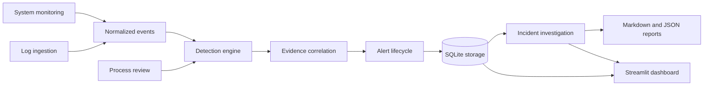

# AI-Powered SOC Toolkit

An educational, defensive SOC application for authorized local monitoring on Windows 11. It collects system/process telemetry, ingests supported exported logs, applies explainable rules, stores events and cases in SQLite, and provides a Streamlit dashboard. Detection matches are investigation leads, not proof of compromise.

## Architecture



## Technologies

- Python 3.12+ (compatible with the installed Python 3.13), dataclasses and type hints for models.
- `psutil` for local metrics and process metadata.
- SQLite for local events, detections, alerts, incidents, notes, and status history.
- Streamlit and Plotly for the dashboard; pandas is optional and not required by the current implementation.
- pytest for the test suite; Python logging for local application diagnostics.

## Windows 11 and VS Code setup

Open this folder in VS Code and use its PowerShell terminal:

```powershell
python --version
python -m venv .venv
.\.venv\Scripts\Activate.ps1
python -m pip install --upgrade pip
python -m pip install -r requirements.txt
```

If PowerShell does not allow activation, do not change its execution policy. Use the environment's interpreter directly:

```powershell
.\.venv\Scripts\python.exe -m pip install -r requirements.txt
```

## Launch the dashboard

From the project root with the virtual environment active:

```powershell
streamlit run soc_toolkit/dashboard.py
```

Without activating the environment:

```powershell
.\.venv\Scripts\python.exe -m streamlit run soc_toolkit/dashboard.py
```

The package launcher is also available as `python -m soc_toolkit` or `python -m soc_toolkit.main`. The dashboard initializes local state under `soc_data/` on first run. This directory, SQLite databases, logs, `.env`, and virtual environments are excluded from Git.

## Sample-data walkthrough

1. Launch the dashboard and open **Log Analysis**.
2. Upload `sample_data/linux_auth.log` and keep format set to `auto`.
3. The file contains five synthetic failed SSH logins followed by a success with the same username and documentation-only source IP (`192.0.2.44`). Expected results include a repeated-failed-login detection and failed-login-followed-by-success detection.
4. Upload `sample_data/windows_security_events.xml`. Its synthetic Windows Security events contain IDs 4625 followed by 4624 for a shared host/account/IP, producing a failed-then-success detection.
5. Review persisted alerts, correlate by available identity fields, create an incident, add typed investigation notes, then build/download a redacted report.

The samples are fabricated and do not represent collected endpoint data. They are safe test fixtures, not attack instructions.

## Reproducible demonstration and manual dashboard checklist

From the project root in PowerShell, launch the dashboard with the project environment:

```powershell
.\.venv\Scripts\python.exe -m streamlit run soc_toolkit/dashboard.py
```

Streamlit prints a local URL. Open it in a browser. To stop the server, return to that same terminal and press `Ctrl+C` once. The demonstration uses only the synthetic files in `sample_data/`; it does not need administrator privileges, external services, or optional AI.

1. Open **Overview**. Confirm CPU, memory, disk, and uptime render; first launch should show an empty alert state.
2. Open **System Monitoring**, click **Collect snapshot**, and confirm a snapshot is shown. Resource alerts depend on the measured values and configured thresholds, so an alert is not guaranteed.
3. Open **Process Analysis**. Review any configured path indicators. A path match requests analyst review; it is not a malware verdict.
4. Open **Log Analysis**, upload `sample_data/linux_auth.log`, leave **Format** as `auto`, and click **Parse and analyze**. Expected: 6 normalized events, no parse errors, a repeated-failed-login detection, and failed-then-success detections. The sample has five failed logins followed by one success sharing the same available identity fields.
5. Upload `sample_data/windows_security_events.xml` the same way. Expected: 3 normalized events and failed-then-success detections from event IDs 4625 followed by 4624. This small fixture does not meet the repeated-login threshold of five.
6. Open **Alerts**. Inspect the severity, reason, evidence references, and recommended steps. Change one alert to **investigating** and save; it should remain filtered under that status.
7. Open **Correlation**. The synthetic events share host, username, or source-IP evidence, so related events should appear together. Time proximity alone is not enough to form a group.
8. Open **Incidents**, create a case, link relevant alerts and events, enter observed facts and recommendations, and add a typed investigation note. Change the case status if appropriate.
9. Open **Reports**, select the case, enable username and IP redaction, build the report, and inspect/download both Markdown and JSON. Secret-like assignments are redacted regardless of those optional toggles. Reports are triage documents and do not establish forensic admissibility.
10. Open **Settings** to inspect session-level thresholds and optional AI configuration. Keep external AI disabled for this demonstration; offline explanations do not send data.

The automated suite covers the service workflow and a Streamlit overview smoke test. The manual dashboard interactions above have not been browser-tested by the project automation. If a screen differs, note the section, action, and displayed error before changing the database or settings.

## Detection rule coverage

All detections are explainable rule matches and investigation leads. The application does not calculate a numeric confidence score; severity is not a confidence score.

| Rule | Required input and logic | Severity / expected output | Positive and negative coverage | Limitations |
| --- | --- | --- | --- | --- |
| Authentication failure text | Event message matches configured authentication-failure patterns (for example, failed login, invalid user, or Windows event ID 4625). | High; rule ID, reason, evidence reference, and investigation steps. | Windows CSV parsing and custom rules are tested; not every text variant has a paired negative test. | Detection depends on the imported message matching a configured pattern. |
| Repeated failed logins | Failed event type/message plus available source-IP, username, or host identity; at least the configured count must fit the time window. | High; `REPEATED_FAILED_LOGINS`, count/context reason, and references. | Synthetic Linux sample exercises the positive case; below-threshold and identity-field variation are not comprehensively tested. | Identity grouping uses the available identity tuple; changing or missing identity fields can split events. |
| Failed login followed by success | A failure and later success share at least one nonempty host, username, or source IP within the configured window. | High; `FAILED_THEN_SUCCESS`, shared-field reason, and both references. | Linux and Windows synthetic samples exercise positive cases; boundary/out-of-order sequence coverage is limited. | Shared identity fields are evidence for review, not proof that one actor caused both events. |
| Repeated event type | Same non-generic event type on the same host reaches the configured count inside the window. | Medium; `REPEATED_SECURITY_EVENT` and event references. | Rule path is implemented; dedicated positive/negative coverage is limited. | Repeated benign activity can trigger the rule; host is the grouping field. |
| Process path review | Executable path contains a configured review indicator such as a user temp or downloads path. | Medium; `PROCESS_PATH_REVIEW` with the matched path and review reason. | Synthetic path-indicator and benign-path tests pass. | A path or process name does not establish maliciousness; no process is stopped or changed. |
| System resource thresholds | CPU, memory, or disk percentage meets the configured warning or critical threshold. Missing metrics are ignored. | High at warning threshold, Critical at critical threshold; metric, measured value, and threshold are included. | Mocked metric collection, configurable warning thresholds, and a critical CPU case are tested. | A high resource value is not attributed to an attack and can have benign causes. |

The service-level suite also checks event deduplication, malformed/oversized inputs, correlation identity and time boundaries, incident notes, and redacted report content. Alert deduplication suppresses matching source/rule/message alerts inside its configured interval.

## Report scope

Current case reports include linked events, alerts with rule identifiers and reasons, investigation notes, recommendations, uncertainty, and limitations. They do not yet include correlation groups or optional AI commentary as separate report sections. External AI remains optional and unverified against a real provider.

## Modules and data flow

- `models.py`, `config.py`, `settings.py`: shared typed models and local defaults.
- `monitoring.py`, `process_analysis.py`: system snapshot, uptime, process inventory, and explainable path indicators.
- `log_analysis.py`: streaming syslog, JSONL, CSV, and Windows Event XML ingestion; malformed-record reporting and normalization.
- `detection.py`, `correlation.py`: threshold, login-sequence, repeated-event, configured-rule, process, and evidence-led correlation logic.
- `alerts.py`, `storage.py`: alert persistence, filters, status lifecycle, duplicate suppression, SQLite schema versioning and transactions.
- `investigation.py`: incidents, typed notes, status, and timelines.
- `reports.py`: Markdown/JSON incident reports with configurable username/IP redaction.
- `dashboard.py`, `main.py`: Streamlit UI and launch entry point.
- `ai_analysis.py`: offline explanations by default; optional provider interface requires configuration and explicit consent.

## Rules and settings

Edit `soc_toolkit/settings.py` and `soc_toolkit/config.py` to change warning/critical thresholds, process path indicators, log size limits, deduplication windows, and correlation windows. Alerts support INFO, LOW, MEDIUM, HIGH, and CRITICAL severities and open, investigating, resolved, and false-positive statuses. Correlation requires shared host, username, or network fields; time proximity alone is not enough.

## Optional AI

No AI request is made by default. Offline rule explanations always work. An optional OpenAI-compatible provider can be injected through `ai_analysis.py`; it requires an HTTPS endpoint, an API key supplied through an environment variable, an enabled setting, and explicit consent. Only a selected alert summary and selected evidence snippets are passed through basic IP, email, username, and secret-pattern redaction. Review the sanitized payload and provider terms before enabling it. Never configure credentials in source code. The app reads environment variables from its process; `.env.example` documents the variable names but is not automatically loaded.

## Tests

Install dependencies from `requirements.txt`, then run:

```powershell
python -m pytest -q
```

Without activation, run `.\.venv\Scripts\python.exe -m pytest -q`.

The suite uses mocked system data and synthetic logs. It must not require administrator access, external scans, live attacks, private logs, or external AI access.

## Limitations and ethical use

- Windows logs must be exported as XML or CSV; the toolkit does not read the native Windows Event Log service or binary EVTX files.
- It is a learning and triage tool, not a replacement for an EDR/SIEM, and its rules can produce false positives or miss events.
- Path indicators do not prove malware. No process is terminated, quarantined, or modified.
- Reports do not establish chain of custody, forensic integrity, or legal admissibility.
- Use only on systems and logs you are authorized to inspect. Imported records are stored locally in SQLite; avoid real sensitive logs unless you understand and accept that local retention.

## Troubleshooting

- If `streamlit` is not found, confirm the VS Code interpreter is `.venv` and reinstall with `python -m pip install -r requirements.txt`.
- If `psutil` cannot read a process path, the process remains in the inventory with that path unavailable.
- If log parsing reports malformed records, inspect the synthetic fixtures first and choose the matching format explicitly.
- Remove `soc_data/` only when you intentionally want to discard the local database, alerts, and reports.

## Future improvements

Potential next steps include richer Windows/Linux event mappings, schema migrations as the data model evolves, deterministic dashboard interaction tests with Streamlit's test utilities, and additional analyst-reviewed detection rules. Native Windows Event Log collection remains out of scope until implemented and tested.
