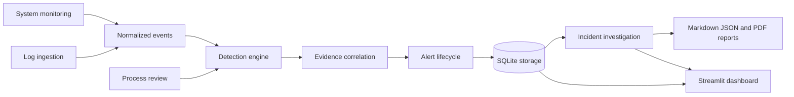

# AI-Powered SOC Toolkit

An educational, defensive SOC application for authorized local monitoring on Windows 11. It collects system/process telemetry, ingests supported exported logs, applies explainable rules, stores events and cases in SQLite, and provides a Streamlit dashboard. Detection matches are investigation leads, not proof of compromise.

## Architecture



## Technologies

- Python 3.12+ (compatible with the installed Python 3.13), dataclasses and type hints for models.
- `psutil` for local metrics and process metadata.
- SQLite for local events, detections, alerts, incidents, notes, and status history.
- ReportLab for paginated Unicode-aware PDF reports; pypdf validates generated report content in tests.
- Streamlit and Plotly for the dashboard; pandas is optional and not required by the current implementation.
- pytest for the test suite; Python logging for local application diagnostics.

## Windows 11 and VS Code setup

Open this folder in VS Code and use its PowerShell terminal:

```powershell
python --version
python -m venv .venv
.\.venv\Scripts\Activate.ps1
python -m pip install --upgrade pip
python -m pip install -r requirements.txt
```

The requirements include `python-evtx` for native `.evtx` parsing, ReportLab for PDF generation, and pypdf for PDF report validation in the test suite. To update an existing virtual environment after upgrading the project, run `python -m pip install -r requirements.txt` (or `\.venv\Scripts\python.exe -m pip install -r requirements.txt` without activation). EVTX files are parsed locally; no external service is contacted. The repository does not bundle a real EVTX fixture, so native record parsing must be validated with an authorized sample on the target environment.

If PowerShell does not allow activation, do not change its execution policy. Use the environment's interpreter directly:

```powershell
.\.venv\Scripts\python.exe -m pip install -r requirements.txt
```

## Launch the dashboard

From the project root with the virtual environment active:

```powershell
streamlit run soc_toolkit/dashboard.py
```

Without activating the environment:

```powershell
.\.venv\Scripts\python.exe -m streamlit run soc_toolkit/dashboard.py
```

The package launcher is also available as `python -m soc_toolkit` or `python -m soc_toolkit.main`. The dashboard initializes local state under `soc_data/` on first run. This directory, SQLite databases, logs, `.env`, and virtual environments are excluded from Git.

The Streamlit dashboard uses the dark navy theme in `.streamlit/config.toml`. Its overview cards use exact SQLite event and alert counts; the process card reports the current sample capped at 100 entries. The local-workspace badge indicates that dashboard storage initialized, not that the host is threat-free.

## Sample-data walkthrough

1. Launch the dashboard and open **Log Analysis**.
2. Upload `sample_data/linux_auth.log` and keep format set to `auto`.
3. The file contains five synthetic failed SSH logins followed by a success with the same username and documentation-only source IP (`192.0.2.44`). Expected results include a repeated-failed-login detection and failed-login-followed-by-success detection.
4. Upload `sample_data/windows_security_events.xml`. Its synthetic Windows Security events contain IDs 4625 followed by 4624 for a shared host/account/IP, producing a failed-then-success detection.
5. Review persisted alerts, correlate by available identity fields, create an incident, add typed investigation notes, then build/download a redacted report.

The samples are fabricated and do not represent collected endpoint data. They are safe test fixtures, not attack instructions.

### Mentor demo: `synthetic_auth_demo.log`

This explicitly labelled RFC3164 syslog fixture contains eight records: two routine events, five failed logins from the documentation-only IP `198.51.100.44` across five synthetic usernames on one synthetic host, then one successful login. All timestamps are within the configured 900-second correlation window. The default repeated-login threshold is five.

1. From the project root, start the app with `\.venv\Scripts\python.exe -m streamlit run soc_toolkit/dashboard.py` and open the local URL Streamlit prints.
2. Select **Log Analysis**, upload `sample_data/synthetic_auth_demo.log`, leave **Format** as `auto`, then click **Parse and analyze**.
3. Confirm **8 events parsed** and **0 parse errors**. Lines 1–2 are routine `syslog` events; lines 3–7 are failed logins; line 8 is a successful login. The normalized auth events include `host`, `username`, `source_ip`, timestamp, event type, and a file evidence reference such as `synthetic_auth_demo.log:3`.
4. Expected new detections: one **HIGH `REPEATED_FAILED_LOGINS`** detection referencing the five failures, and five **HIGH `FAILED_THEN_SUCCESS`** detections (one per earlier failure paired with the later success). The repeated-login rule reason is `5 failed-login events shared validated source IP 198.51.100.44 within the configured time window, across the observed account/host values.` Persisted alert text redacts the IP as `[IP]`. Alert evidence references are normalized event IDs; the dashboard currently shows the file-line references on event rows and the IDs in detection/alert evidence, without a direct ID-to-line mapping.
5. The two routine records should not appear in those detection evidence references. Open **Alerts** to inspect persisted alert reasons and references. **Correlation** should group records only when shared host, username, or source-IP evidence is present.

On a first import into the local database, the upload should create six alerts from this fixture. Re-importing the same file is deduplicated and can report zero new alerts; it should not create duplicates. The test suite runs the fixture through the real parser, detector, and SQLite alert-persistence helper.

## Reproducible demonstration and manual dashboard checklist

From the project root in PowerShell, launch the dashboard with the project environment:

```powershell
.\.venv\Scripts\python.exe -m streamlit run soc_toolkit/dashboard.py
```

Streamlit prints a local URL. Open it in a browser. To stop the server, return to that same terminal and press `Ctrl+C` once. The demonstration uses only the synthetic files in `sample_data/`; it does not need administrator privileges, external services, or optional AI.

1. Open **Overview**. Confirm CPU, memory, disk, and uptime render; first launch should show an empty alert state.
2. Open **System Monitoring**, click **Collect snapshot**, and confirm a snapshot is shown. Resource alerts depend on the measured values and configured thresholds, so an alert is not guaranteed.
3. Open **Process Analysis**. Review any configured path indicators. A path match requests analyst review; it is not a malware verdict.
4. Open **Log Analysis**, upload `sample_data/linux_auth.log`, leave **Format** as `auto`, and click **Parse and analyze**. Expected: 6 normalized events, no parse errors, a repeated-failed-login detection, and failed-then-success detections. The sample has five failed logins followed by one success sharing the same available identity fields.
5. Upload `sample_data/windows_security_events.xml` the same way. Expected: 3 normalized events and failed-then-success detections from event IDs 4625 followed by 4624. This small fixture does not meet the repeated-login threshold of five.
6. Open **Alerts**. Inspect the severity, reason, evidence references, and recommended steps. Change one alert to **investigating** and save; it should remain filtered under that status.
7. Open **Correlation**. The synthetic events share host, username, or source-IP evidence, so related events should appear together. Time proximity alone is not enough to form a group.
8. Open **Incidents**, create a case, link relevant alerts and events, enter observed facts and recommendations, and add a typed investigation note. Change the case status if appropriate.
9. Open **Reports**, select the case, enable username and IP redaction, build the report, and inspect/download Markdown, JSON, and PDF. Secret-like assignments are redacted regardless of those optional toggles. Reports are triage documents and do not establish forensic admissibility.
10. Open **Settings** to inspect session-level thresholds and optional AI configuration. Keep external AI disabled for this demonstration; offline explanations do not send data.

The automated suite covers the service workflow and a Streamlit overview smoke test. The manual dashboard interactions above have not been browser-tested by the project automation. If a screen differs, note the section, action, and displayed error before changing the database or settings.

## Detection rule coverage

All detections are explainable rule matches and investigation leads. The application does not calculate a numeric confidence score; severity is not a confidence score.

| Rule | Required input and logic | Severity / expected output | Positive and negative coverage | Limitations |
| --- | --- | --- | --- | --- |
| Authentication failure text | Event message matches configured authentication-failure patterns (for example, failed login, invalid user, or Windows event ID 4625). | High; rule ID, reason, evidence reference, and investigation steps. | Windows CSV parsing and custom rules are tested; not every text variant has a paired negative test. | Detection depends on the imported message matching a configured pattern. |
| Repeated failed logins | Failed event type/message plus available source-IP, username, or host identity; at least the configured count must fit the time window. | High; `REPEATED_FAILED_LOGINS`, count/context reason, and references. | Synthetic Linux sample exercises the positive case; below-threshold and identity-field variation are not comprehensively tested. | Identity grouping uses the available identity tuple; changing or missing identity fields can split events. |
| Failed login followed by success | A failure and later success share at least one nonempty host, username, or source IP within the configured window. | High; `FAILED_THEN_SUCCESS`, shared-field reason, and both references. | Linux and Windows synthetic samples exercise positive cases; boundary/out-of-order sequence coverage is limited. | Shared identity fields are evidence for review, not proof that one actor caused both events. |
| Repeated event type | Same non-generic event type on the same host reaches the configured count inside the window. | Medium; `REPEATED_SECURITY_EVENT` and event references. | Rule path is implemented; dedicated positive/negative coverage is limited. | Repeated benign activity can trigger the rule; host is the grouping field. |
| Process path review | Executable path contains a configured review indicator such as a user temp or downloads path. | Medium; `PROCESS_PATH_REVIEW` with the matched path and review reason. | Synthetic path-indicator and benign-path tests pass. | A path or process name does not establish maliciousness; no process is stopped or changed. |
| System resource thresholds | CPU, memory, or disk percentage meets the configured warning or critical threshold. Missing metrics are ignored. | High at warning threshold, Critical at critical threshold; metric, measured value, and threshold are included. | Mocked metric collection, configurable warning thresholds, and a critical CPU case are tested. | A high resource value is not attributed to an attack and can have benign causes. |

The service-level suite also checks event deduplication, malformed/oversized inputs, correlation identity and time boundaries, incident notes, and redacted report content. Alert deduplication suppresses matching source/rule/message alerts inside its configured interval.

### ATT&CK mapping and threat score

Only `REPEATED_FAILED_LOGINS` currently maps to a potential ATT&CK technique: **T1110 Brute Force**, **Credential Access**. The rule demonstrates thresholded repeated authentication failures, which is consistent with T1110, but does not establish malicious intent or distinguish password guessing, spraying, or credential stuffing. No sub-technique is assigned. A potential match requires at least two distinct event references that resolve to supplied events and includes a behavioral qualification. Generic authentication failures, a failed-then-success sequence, path indicators, warning keywords, repeated generic event types, and system metrics are explicitly assessed as unmapped because their current evidence is insufficient to support a technique. See the official [MITRE ATT&CK T1110 entry](https://attack.mitre.org/techniques/T1110/).

The triage score sums capped, documented components, then clamps to 0–100: distinct rule severity (INFO 0, LOW 5, MEDIUM 10, HIGH 20, CRITICAL 25 points per distinct rule; cap 60); unique supporting events (0 for the first, +2 per additional unique event ID; cap 20); independent source files (+5 when at least two sources support matched events); correlated evidence (+5 when an identity-linked group overlaps at least two matched events); and external enrichment (+15 per unique indicator with malicious provider detections, or +5 with suspicious detections; cap 15). Duplicate detection records, event references, repeated event objects with the same event ID, and repeated enrichment results for the same indicator are counted once. Detections whose references do not resolve to supplied events are excluded. Default display bands are LOW below 25, MEDIUM 25–49, HIGH 50–74, and CRITICAL 75–100. `ThreatScoringConfig` in `soc_toolkit/settings.py` and its `AppConfig` value expose these factors and thresholds for configuration.

This score is an analyst prioritization aid, not a probability, attribution, or compromise verdict. Offline, missing, unavailable, and no-match intelligence contribute zero points and do not indicate benign activity. A score of zero does not establish safety. External enrichment contributes only when a provider result is explicitly linked to the matched evidence.

## Report scope

Case reports include linked events and alerts, derived detections and correlations, extracted IOCs, potential ATT&CK mappings, investigation notes, analyst review decisions, safe AI activity summaries, recommendations, uncertainty, and limitations. PDF reports are generated with ReportLab from the same redacted case payload used by Markdown and JSON. External AI remains optional and unverified against a real provider.

## Analyst review and AI audit trail

Use **Alerts** to record one of four append-only decisions for a finding: `confirmed`, `false_positive`, `needs_review`, or `dismissed`. A reviewer name is stored only when entered. Decision transitions are checked; prior review rows and relevant status history remain available. Review notes and metadata pass through the storage sanitizers before persistence.

AI request activity is stored separately from analyst decisions. Audit rows contain provider/model labels, request time, linked case/evidence references, status, safe summary, and transmitted field names only. Prompts, selected evidence text, and API keys are not written to this table. Report redaction applies to reviewer identities, notes, and AI summaries. The SQLite schema migrates additively from version 1 to version 2 when the app opens the database.

## Modules and data flow

- `models.py`, `config.py`, `settings.py`: shared typed models and local defaults.
- `monitoring.py`, `process_analysis.py`: system snapshot, uptime, process inventory, and explainable path indicators.
- `log_analysis.py`: streaming syslog, JSONL, CSV, Windows Event XML, and native EVTX ingestion; malformed-record reporting and normalization. Native EVTX parsing uses `python-evtx`.
- `ioc_extraction.py`: validated IPv4/IPv6, domain, URL, MD5, SHA-1, and SHA-256 extraction from normalized events or text, with source evidence references. Indicators are labelled extracted, not malicious; private and reserved IP ranges are identified by scope.
- `detection.py`, `correlation.py`: threshold, login-sequence, repeated-event, configured-rule, process, and evidence-led correlation logic.
- `attack_mapping.py`, `threat_scoring.py`: conservative potential ATT&CK matches and a configurable, evidence-linked 0–100 triage score.
- `storage.py`, `investigation.py`: append-only analyst decision history and separate AI activity audit records.
- `alerts.py`, `storage.py`: alert persistence, filters, status lifecycle, duplicate suppression, SQLite schema versioning and transactions.
- `investigation.py`: incidents, typed notes, status, and timelines.
- `reports.py`: redacted Markdown/JSON case payloads and paginated PDF report generation.
- `dashboard.py`, `main.py`: Streamlit UI and launch entry point.
- `ai_analysis.py`: offline, event-linked structured alert/case summaries; optional provider suggestions require configuration and explicit consent and remain separate from observed facts, ATT&CK assessment, and recommendations.

## Rules and settings

Edit `soc_toolkit/settings.py` and `soc_toolkit/config.py` to change warning/critical thresholds, process path indicators, log size limits, deduplication windows, and correlation windows. Alerts support INFO, LOW, MEDIUM, HIGH, and CRITICAL severities and open, investigating, resolved, and false-positive statuses. Correlation requires shared host, username, or network fields; time proximity alone is not enough.

## Optional AI

No AI request is made by default. The Settings assistant builds a local structured summary from alert-linked events and any explicitly linked case: observed facts, supporting evidence references, uncertainty, existing next steps, and evidence-qualified potential ATT&CK matches. Unsupported rules are shown as unmapped. Optional AI provider text appears separately as an unverified hypothesis. An optional OpenAI-compatible provider can be injected through `ai_analysis.py`; it requires an HTTPS endpoint, an API key supplied through an environment variable, an enabled setting, and explicit consent. Only the selected alert summary and explicitly selected evidence snippets are sent after sanitization; case event bodies are not sent automatically. Review the preview and provider terms before enabling it. Never configure credentials in source code. The app reads environment variables from its process; `.env.example` documents the variable names but is not automatically loaded.

## Threat intelligence enrichment

Threat intelligence is offline by default. Local extraction results are labelled `extracted`; they are not verdicts. To enable optional VirusTotal v3 lookups, set `SOC_VIRUSTOTAL_API_KEY` in the dashboard process environment, restart the app, open **Threat Intelligence**, select **VirusTotal (external lookup)**, select one indicator, and confirm the disclosure checkbox before clicking **Look up selected indicator**. Do not put the key in source code, dashboard inputs, or logs. The client uses the standard library, sends only the selected indicator identifier with an HTTPS GET request, and never uploads a file or event text. The default timeout is 5 seconds and local request spacing is 15 seconds; the values are configurable with `AppConfig.threat_intel_timeout_seconds` and `AppConfig.threat_intel_min_interval_seconds`.

The dashboard skips private/reserved IPs, internal or example domains, and URLs with paths, credentials, queries, or fragments. Hash lookups send the hash itself; confirm that doing so is acceptable before querying a potentially proprietary file hash. VirusTotal documents that queried indicators may be added to its dataset and accessible to its community, and warns against querying sensitive, confidential, or personally identifying indicators. Its public API also has terms and usage limits, including restrictions on commercial products; review the [official API overview](https://docs.virustotal.com/docs/api-overview), [getting started](https://docs.virustotal.com/reference/getting-started), and [URL report reference](https://docs.virustotal.com/reference/url-info) before use. Results are shown in the current dashboard session and are not persisted. `no_match`, `offline`, skipped, or unavailable results do not mean an indicator is benign. The provider interface can be replaced with another implementation without changing IOC extraction.

## Tests

Install dependencies from `requirements.txt`, then run:

```powershell
python -m pytest -q
```

Without activation, run `.\.venv\Scripts\python.exe -m pytest -q`.

The suite uses mocked system data and synthetic logs. It must not require administrator access, external scans, live attacks, private logs, or external AI access.

### Verifying native EVTX parsing

Install the declared parser into this project's virtual environment (no global install):

```powershell
.\.venv\Scripts\python.exe -m pip install -r requirements.txt
```

For an optional real-file integration test, download the 68 KB, seven-record `Security_short_selected.evtx` sample from the `omerbenamram/evtx` parser project's test corpus. The sample's upstream documentation identifies it as benign test data and the parser project is dual licensed MIT/Apache-2.0. Query-farm's [sample fixture notes](https://github.com/Query-farm/vgi-evtx/blob/main/test/sql/data/README.md) document the file provenance, event IDs, and licensing context. Download it to `sample_data`:

```powershell
Invoke-WebRequest `
  -Uri "https://raw.githubusercontent.com/omerbenamram/evtx/master/samples/Security_short_selected.evtx" `
  -OutFile "sample_data\Security_short_selected.evtx"
$env:SOC_TEST_EVTX_PATH = (Resolve-Path "sample_data\Security_short_selected.evtx").Path
.\.venv\Scripts\python.exe -m pytest -q tests/test_ioc_evtx.py -k real_evtx_fixture
```

The integration test checks successful native parsing and normalized event IDs, timestamps, computer names, providers, messages, and evidence references. User/account values are checked when present in the selected records. Mocked tests separately exercise malformed input, size limits, and missing-parser behavior. The downloaded sample is not committed by these instructions; verify its license and provenance before redistributing it. For the current 68 KB sample, event IDs are `5152, 4611, 4776, 4625, 5152, 5157, 4673`.

To upload an EVTX file in the dashboard, start the app as described above, open **Log analysis**, choose **EVTX** (or leave **auto** selected for a `.evtx` filename), select the file, then click **Parse and analyze**. Parsing is local and the upload is subject to the configured maximum log size. The importer does not execute file contents.

## Limitations and ethical use

- Native `.evtx` file ingestion uses `python-evtx`; the application does not read the live Windows Event Log service. The repository does not bundle a binary EVTX fixture. Set `SOC_TEST_EVTX_PATH` to a legally obtained sample to run the optional native-parser integration test; without it, that test is skipped and the default suite's EVTX parser-interface tests remain mocked.
- IOC extraction validates and labels candidate values but does not assess reputation or maliciousness. Common example domains are excluded, and private/reserved IPs are marked by scope rather than treated as malicious.
- It is a learning and triage tool, not a replacement for an EDR/SIEM, and its rules can produce false positives or miss events.
- Path indicators do not prove malware. No process is terminated, quarantined, or modified.
- Reports do not establish chain of custody, forensic integrity, or legal admissibility.
- PDF generation requires ReportLab; pypdf is used by tests to validate generated report text and metadata.
- Use only on systems and logs you are authorized to inspect. Imported records are stored locally in SQLite; avoid real sensitive logs unless you understand and accept that local retention.

## Troubleshooting

- If `streamlit` is not found, confirm the VS Code interpreter is `.venv` and reinstall with `python -m pip install -r requirements.txt`.
- If `psutil` cannot read a process path, the process remains in the inventory with that path unavailable.
- If log parsing reports malformed records, inspect the synthetic fixtures first and choose the matching format explicitly.
- Remove `soc_data/` only when you intentionally want to discard the local database, alerts, and reports.

## Future improvements

Potential next steps include richer Windows/Linux event mappings, schema migrations as the data model evolves, deterministic dashboard interaction tests with Streamlit's test utilities, and additional analyst-reviewed detection rules. Native Windows Event Log collection remains out of scope until implemented and tested.
